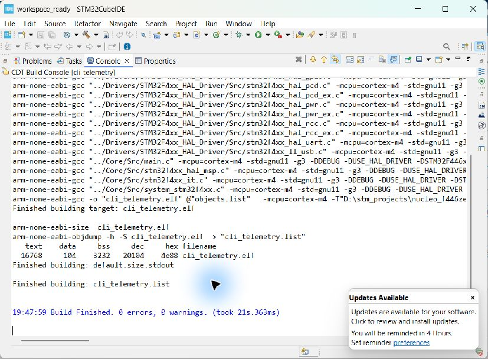

# Your first STM32 project: from an empty folder to working hardware

This tutorial assumes no embedded-programming experience. Its worked example is **cli_telemetry on NUCLEO-F446ZE**, using Windows, STM32CubeIDE **2.1.1**, standalone STM32CubeMX and PuTTY. Menu names can differ in other releases. The existing project on this PC has already been built, flashed and tested; you do not need to recreate it just to run it.

**Choose your route:** To test the existing board, start at step 23. To edit the existing project, start at step 16, using its existing workspace. To learn from an empty project, follow every step in order in a new folder. Do not overwrite the working example accidentally.

**Learn the reasoning as you go:** The [Engineering lessons](#engineering-lessons-how-to-choose-values-and-write-the-logic) below explain the decisions behind every group of steps, with calculations, annotated C, design exercises and answers. Read the matching lesson before copying a setting.

## Understand the pieces first

| Word | Meaning |
|---|---|
| STM32 / MCU | The programmable microcontroller chip on the board. |
| Nucleo | The development board containing the MCU, power circuitry, connectors and programmer. |
| Firmware | The program running inside the MCU. |
| ST-LINK | The onboard programmer/debugger. It also bridges UART data to USB on this board. |
| CubeMX | The graphical tool that selects pins/clocks and generates initialization code. |
| CubeIDE | The editor, compiler and debugger used to build and run the program. |
| HAL | ST's C library for controlling peripherals without manually programming every hardware register. |
| Peripheral | A hardware function inside the MCU, such as UART, timer or ADC. |
| UART / USART | Hardware that sends and receives serial bytes. Asynchronous USART mode is used here. |
| COM port | Windows' name for a serial connection; this board was assigned COM3. |
| Workspace | CubeIDE's folder for project references and IDE preferences. |
| Project folder | The folder containing this project's source code and configuration. It can be outside the workspace. |
| Build | Compile and link C source into a program file. It does not put that file on the board. |
| Flash | Write the program into the MCU's persistent flash memory. |
| Run | Launch the program on the board, usually after building and flashing. |
| Debug | Run with controls to pause, inspect variables and step through code. It may stop at main(). |
| Reset | Restart the firmware already stored on the board; it does not erase it. |

The workflow is **configure → generate → import → write code → build → flash → test**. The workflow transfers to other STM32 projects; this tutorial's particular clock values and pin names do not.

## Prepare the PC and board

### 1. Gather the hardware

Use a NUCLEO-F446ZE and a USB cable that carries data, not just power. For this first test, disconnect external circuits from the board and use its normal factory jumper configuration. No external UART adapter or jumper wires are required: the onboard ST-LINK carries this project's UART connection.

**Check:** Read NUCLEO-F446ZE on the board. A similar-looking Nucleo with a different part number may need different settings.

### 2. Identify the correct USB connection

Locate the connector in the ST-LINK section of the board, using its printed labels and the board layout in [ST's UM1974 manual](https://www.st.com/resource/en/user_manual/dm00244518-stm32-nucleo144-boardsstmicroelectronics.pdf). Connect the PC there. The other USB connector belongs to the target MCU and is not the programming/virtual-COM connection used here. Connector markings and revisions should be checked against the actual board rather than inferred from its orientation on your desk.

**Check:** Power/status LEDs should illuminate. LEDs alone do not prove that the cable carries data.

### 3. Install or locate STM32CubeIDE

Get the Windows installer from [ST's STM32CubeIDE page](https://www.st.com/en/development-tools/stm32cubeide.html). Read the license and follow the installer, retaining the included ST-LINK driver components. If Windows requests administrator permission, review and approve the genuine ST installer yourself. Allow any required restart. On this PC CubeIDE 2.1.1 is already installed at `C:\ST\STM32CubeIDE_2.1.1\STM32CubeIDE\stm32cubeide.exe`; reinstalling is unnecessary.

**Check:** Launch it from the Start menu by typing STM32CubeIDE. A workspace selector should appear, unless a default workspace was previously saved.

### 4. Install or locate standalone STM32CubeMX

Use [ST's STM32CubeMX page](https://www.st.com/en/development-tools/stm32cubemx.html) to obtain the Windows installer. Complete ST's download/sign-in or guest-download process if presented, then follow the installer. Use STM32CubeMX with support for STM32F4; this tutorial is not a CubeMX2 tutorial. On this PC the application is already installed at `C:\Users\Shayan\AppData\Local\Programs\STM32CubeMX\STM32CubeMX.exe`.

CubeIDE 2.x uses standalone CubeMX for this workflow. If an older video tells you to open an integrated board wizard inside CubeIDE, follow this tutorial's standalone route instead. [ST's 2.x workflow explanation](https://community.st.com/stm32-mcus-60/stm32cubeide-2-0-0-workflow-tutorial-160701) describes this separation.

**Check:** CubeMX opens with a new-project/board-selection option. An `.ioc` file is its saved project configuration, not an executable program.

### 5. Install or locate PuTTY

Use the official [PuTTY download page](https://www.chiark.greenend.org.uk/~sgtatham/putty/latest.html) and select a Windows build suitable for your PC. PuTTY is already installed here at `C:\Program Files\PuTTY\putty.exe`. This tutorial uses it only as a serial terminal; no internet server, SSH account or password is needed.

**Check:** PuTTY opens a configuration window containing a Serial connection type.

### 6. Confirm that Windows sees the board

Right-click the Windows Start button, choose Device Manager, then expand Ports (COM & LPT). Find **STMicroelectronics STLink Virtual COM Port (COMx)** and write down its COM number. The working board on this PC is **COM3**. It may be different on another PC. ST-Link Debug should also be present in Windows' USB device inventory. If Ports is absent or the device has a warning icon, check the cable/connector first, then the ST-LINK drivers. Do not proceed to serial testing until a usable COM port exists.

**Check:** The COM device appears without a warning icon. Unplugging and reconnecting the board can help identify which entry belongs to it.

### 7. Choose separate project and workspace folders

In File Explorer create a parent folder such as `D:\stm_learning`. Your new project can live at `D:\stm_learning\cli_telemetry`; use `D:\stm_learning\workspace` for CubeIDE's workspace. On a PC without a D: drive, use a writable folder such as `C:\Users\YourName\Documents\stm_learning` instead. Replace example paths consistently throughout the tutorial.

The existing verified project is at `D:\stm_projects\nucleo_f446ze_ready\cli_telemetry`; its workspace is `D:\stm_projects\workspace_ready`. Keep these if you are following the edit-existing route. If you want a second project with the same name, use a separate workspace to avoid duplicate-name conflicts.

**Check:** You know which folder contains code and which contains IDE preferences. Do not create or edit files inside a workspace's hidden `.metadata` folder.

## Configure the new project in CubeMX

### 8. Select the board

Open CubeMX. Choose Access to Board Selector, or File → New Project followed by the Board Selector tab. Search Commercial Part Number for **NUCLEO-F446ZE**. Select the matching board, whose MCU is STM32F446ZET6/STM32F446ZETx, and choose Start Project (or Next in a version that presents that button). Choose **Yes** when asked to initialize peripherals with their default modes.

**Check:** The pinout view names STM32F446ZETx and NUCLEO-F446ZE. If it names another device, correct the selection before continuing.

### 9. Name the project and select the IDE output

Open Project Manager → Project. Enter `cli_telemetry` as Project Name and your parent folder as Project Location. Set Toolchain/IDE to **STM32CubeIDE** and keep **Generate Under Root** selected if offered. CubeMX will create the project subfolder. This route generates C source for a firmware executable; it does not require the older integrated wizard's separate C/Executable choices.

**Check:** The resulting project path is the folder you intended, not the workspace metadata folder or an existing project you want to keep.

### 10. Verify the oscillator source

Under Pinout & Configuration → System Core → RCC, verify HSE is **Bypass Clock Source**. This board configuration uses an **8 MHz clock supplied by the powered ST-LINK**, rather than treating the input as a crystal. In Clock Configuration verify the HSE input frequency is 8 MHz. Do not select Crystal/Ceramic Resonator merely because it appears in a tutorial for a different board.

**Check:** HSE is enabled and shows 8 MHz. Keep ST-LINK powered when running this configuration.

### 11. Set the main clock to 180 MHz

Open Clock Configuration. Set HCLK to **180 MHz** and press Enter. If CubeMX offers an automatic solver, it may be used, but inspect its result. The solver stalled during our original setup; the following manually entered settings are the known working configuration. Set the PLL source mux to HSE, PLLM to 4, PLLN to 180, PLLP to 2, PLLQ to 7 and PLLR to 2. Set the system-clock mux to PLLCLK, AHB prescaler to /1, APB1 prescaler to /4 and APB2 prescaler to /2. Drop-down selections must be committed; click elsewhere and confirm the displayed result.

| Clock | Expected result |
|---|---:|
| PLL input | 8 MHz / 4 = 2 MHz |
| Main PLL VCO | 2 MHz × 180 = 360 MHz |
| SYSCLK and HCLK | 360 MHz / 2 = 180 MHz |
| APB1 peripheral clock | 45 MHz |
| APB2 peripheral clock | 90 MHz |

**Check:** HCLK says 180, not merely an uncommitted text entry. Pink/red fields mean configuration issues remain. These values are for this MCU/board, not every STM32.

### 12. Give the default USB peripheral a valid clock

Initializing all board defaults enables USB_OTG_FS. At the settings above, main PLLQ is about 51.43 MHz, which is not the required 48 MHz USB clock. In the clock diagram find PLL48CLK Mux and select **PLLSAIP**. In the PLLSAI section set **M=4, N=192, P=8**. The resulting output is 8 / 4 × 192 / 8 = **48 MHz**. Retain the other generated default settings unless CubeMX indicates a problem.

**Check:** The USB clock reads 48 MHz, HCLK still reads 180 MHz, and the clock-error indicator/pink fields have disappeared. The project's serial output uses the separate ST-LINK bridge; this USB setting is needed because we retained the target MCU's board-default USB peripheral.

### 13. Configure the UART

Return to Pinout & Configuration → Connectivity → **USART3**. Choose **Asynchronous** mode. Open its Parameter Settings and verify baud rate **115200**, word length **8 bits**, parity **None**, stop bits **1**, mode **Transmit and Receive**, hardware flow control **None**, oversampling **16**. In the pinout confirm **PD8 = USART3_TX** and **PD9 = USART3_RX**. The board labels may identify PD8 as STLK_RX and PD9 as STLK_TX: those labels describe the other chip's perspective and are not reversed wiring.

**Check:** PD8 and PD9 are assigned to USART3. Do not enable USART2 as a substitute. The board's default routing connects USART3 to ST-LINK, so no external wires are necessary. [Board reference: UM1974](https://www.st.com/resource/en/user_manual/dm00244518-stm32-nucleo144-boardsstmicroelectronics.pdf).

### 14. Preserve your code during generation

In Project Manager → Code Generator, ensure the option to **Keep User Code when re-generating** is enabled. Save the configuration. Later edits must still stay inside USER CODE blocks or in separate application files; this option does not preserve arbitrary edits everywhere in generated files.

**Check:** The project folder contains `cli_telemetry.ioc`. Keep this file: it lets you reopen and change the hardware configuration.

### 15. Generate code and let packages finish installing

Click Generate Code. If CubeMX asks to download a missing STM32CubeF4 firmware package, choose Yes and wait. Our project uses **STM32Cube FW_F4 V1.28.3**; its installation downloaded a base package and an update, with a separate license acceptance for each. Read the agreements, select acceptance if you agree, and click Finish. Extraction can take several minutes. If a clock-warning dialog appears, choose No and resolve the clock before regenerating. A firewall/security prompt is a Windows permission decision to review yourself; it does not mean code generation has finished.

**Check:** CubeMX explicitly reports successful code generation and shows your project path. The folder now contains Core, Drivers and IDE project files. Close the success dialog or use Open Project if it opens the intended CubeIDE version.

## Write, build and program the firmware

### 16. Open the CubeIDE workspace

Launch STM32CubeIDE. In the workspace selector enter the workspace folder chosen in step 7 and click Launch. For the existing project use `D:\stm_projects\workspace_ready`. If a default workspace opened instead, use File → Switch Workspace → Other, select the desired folder, and allow the IDE to restart. A welcome page may appear; close its tab to see the workbench.

**Check:** The workbench opens. Project Explorer is normally on the left and Console/Problems near the bottom. If a view is missing, use Window → Show View to reopen it.

### 17. Import the generated project

If cli_telemetry is already listed in this workspace, skip importing. Otherwise choose File → STM32 Project Create/Import. Expand Import STM32 Project, select STM32CubeMX/STM32CubeIDE Project and click Next. Enter the generated **project folder**, not its parent or just the .ioc file, in Import source. Wait for the scan. Leave the single cli_telemetry project checked, then Finish. Accept a C/C++ perspective switch if prompted.

**Check:** Project Explorer shows cli_telemetry. Expand its arrow to see Core and Drivers. If nothing is detected, return to CubeMX and confirm code generation and STM32CubeIDE toolchain selection. If the name already exists, use that project or a separate workspace; do not delete unfamiliar projects to clear the error.

### 18. Learn the important files

| File/folder | What you use it for |
|---|---|
| cli_telemetry.ioc | Hardware/pin/clock configuration opened in CubeMX. |
| Core/Src/main.c | main(), initialization and this example's application code. |
| Core/Inc/main.h | Declarations and generated pin definitions. |
| Core/Src/stm32f4xx_hal_msp.c | Low-level peripheral clocks and GPIO alternate-function setup. |
| Core/Src/syscalls.c | C-library support used by printf's output path. |
| Drivers | ST HAL/CMSIS libraries; leave unchanged for this example. |
| Debug/cli_telemetry.elf | Built firmware with debugging information; generated by Build. |
| .project / .cproject | CubeIDE project configuration; may be hidden in File Explorer. |
| cli_telemetry.launch | Saved launch configuration, created when configuring Run. |

Double-click Core → Src → main.c. The editor should show generated C code with comments beginning USER CODE BEGIN and USER CODE END. Do not replace the entire file with the snippets below.

### 19. Add the standard-I/O header

Find `/* USER CODE BEGIN Includes */` near the top of main.c (Ctrl+F can search for it). Put the include between the existing markers, without duplicating the marker comments:

```c
/* USER CODE BEGIN Includes */
#include <stdio.h>
/* USER CODE END Includes */
```

**Why:** This declares printf, stdout and setvbuf. **Check:** The line is inside the Includes user section, so regeneration keeps it.

### 20. Redirect printf to USART3

Find `/* USER CODE BEGIN 0 */`, which is above `int main(void)` and below the generated `UART_HandleTypeDef huart3;` declaration. Insert this function between that block's existing markers:

```c
/* USER CODE BEGIN 0 */
int __io_putchar(int ch)
{
  HAL_UART_Transmit(&huart3, (uint8_t *)&ch, 1, HAL_MAX_DELAY);
  return ch;
}
/* USER CODE END 0 */
```

**Why:** The project's generated syscall implementation sends printf's characters through this function. It transmits one byte using huart3 and waits for completion. **Check:** There is exactly one definition of __io_putchar, outside main(), and huart3 is declared earlier. This is a simple blocking boot-message implementation, not a high-throughput or interrupt-safe logging design.

### 21. Print after initialization

Inside main(), find `/* USER CODE BEGIN 2 */`. Immediately above it, generated code should call MX_GPIO_Init(), MX_USART3_UART_Init() and, for these board defaults, MX_USB_OTG_FS_PCD_Init(). Insert the following between the existing USER CODE 2 markers:

```c
/* USER CODE BEGIN 2 */
setvbuf(stdout, NULL, _IONBF, 0);
printf("Boot OK - NUCLEO-F446ZE @ 180 MHz\r\n");
printf("Day 1 complete. CLI Telemetry project ready.\r\n");
/* USER CODE END 2 */
```

Do not move these lines before USART3 initialization. Do not put them inside while(1), which would print repeatedly. `\r\n` moves the terminal to the next line; type the backslash characters exactly as shown. setvbuf disables buffering so text is sent immediately. Save with Ctrl+S.

**Check:** The three added pieces match steps 19–21, and the generated initialization/while loop remain intact.

### 22. Build and read the result

Click cli_telemetry in Project Explorer. Choose Project → Build All, or Ctrl+B. Open the Console tab and select the CDT Build Console if another console is displayed. Wait until the build completes. The tested project reports **0 errors, 0 warnings**. Double-clicking a Console tab can enlarge it; double-click again to restore the layout. The actual successful build screenshot is below.



If the build fails, read the **first meaningful compiler error**, not only the final make failure. Missing stdio produces missing declarations; an undeclared huart3 suggests USART3 was not generated or the function was placed too early. Double-click an error in Problems to visit its source line. Save the fix and rebuild. Do not flash an old ELF and assume it contains a failed new build.

### 23. Prepare the board and update ST-LINK when asked

Connect the board as in steps 2 and 6. Select the project and click the green Run arrow in CubeIDE. If it offers an ST-LINK firmware update, choose Yes. In STLinkUpgrade select ST-LINK/V2-1, then click **Open in update mode**. Only after that should firmware information appear and Upgrade become enabled. Click Upgrade and wait without disconnecting the cable. Our successful result was **V2J47M34 — Upgrade successful**. Close the updater afterward so it releases the probe.

**Check:** Do not mistake the initial Unknown fields for a broken driver; in our session entering update mode resolved them. Declining a mandatory update caused Failed to start GDB server. If no device is detected at all, check the cable and Windows device inventory instead.

### 24. Flash and run from CubeIDE

Click the project, then Run. On first launch, confirm the configuration names project cli_telemetry and application `Debug/cli_telemetry.elf`; use the ST-LINK/SWD debugger connection for the onboard probe. Confirm OK/Run. Read the programming console and wait for successful download/verification and execution. If CubeIDE says the selection cannot be launched, select the project first. If you chose Debug and execution pauses at main(), click Resume to let the messages run, or use Run for this exercise.

**Check:** Programming must succeed. A terminated launch is not by itself proof of failure: a Run session may disconnect while firmware continues on the MCU. Conversely, a successful build alone is not proof of a successful flash. This project's final ELF was independently programmed and verified using the bundled STM32CubeProgrammer CLI; see the saved flash log linked below.

## Observe and understand the result

### 25. Set up PuTTY before resetting

Open PuTTY. In Session choose connection type Serial. Enter the actual COM number (COM3 here) in Serial line and **115200** in Speed. Expand Connection on the left, click Serial and verify data bits **8**, stop bits **1**, parity **None**, flow control **None**. Optionally return to Session, enter a name such as NUCLEO-F446ZE in Saved Sessions and click Save so you can load these settings later. Click Open.

**Check:** A terminal window appears without a port-open error. A blank window is normal if startup happened before you opened it. Only one application can own the COM port; close other terminals or serial scripts first.

### 26. Reset and verify the exact output

With PuTTY open, press the board's **black reset button**. Do not confuse it with the user button. You should receive:

```text
Boot OK - NUCLEO-F446ZE @ 180 MHz
Day 1 complete. CLI Telemetry project ready.
```

Press reset again and expect another copy of the same two lines. There is no periodic output and typing commands produces no response. The final firmware's bytes were captured successfully on COM3 after an ST-LINK software reset. Use the manual procedure above to check it yourself in PuTTY.

**Success criterion:** Both exact lines arrive after reset at the expected serial settings. A lit LED or a build-success message alone is insufficient.

### 27. Understand the execution sequence

On reset, startup code initializes memory and calls main(). HAL_Init() starts the HAL/time base; SystemClock_Config() configures the 180 MHz clock and required power/flash settings. Generated functions initialize GPIO, USART3 and the retained USB peripheral. The two printf calls produce text; generated syscall support calls __io_putchar; HAL_UART_Transmit sends characters out PD8. The ST-LINK receives those UART bytes and forwards them through USB to the PC's virtual COM port. After printing, the MCU remains in the empty while(1) loop until reset.

```text
main.c printf → __io_putchar → USART3 TX / PD8
                               ↓
                     onboard ST-LINK UART bridge
                               ↓ USB
                     Windows COM3 → terminal text
```

The words “180 MHz” are fixed text, not a frequency measurement performed by printf. The clock was checked separately using generated code and live RCC registers. This project proves the development/flash/UART path works. It does not yet implement a CLI parser, sensors or continuous telemetry.

### 28. Make your first controlled edit

Change only the second message to `printf("My first STM32 edit works.\r\n");` in USER CODE 2. Save, Build, Run, and reset with the terminal open if needed. Confirm the changed line appears. Then restore the original line, save, build and flash again if you want the documented reference behavior. This exercise is optional and was not applied to the delivered project.

**Lesson:** Editing a file changes the PC copy. Build creates a new ELF. Flash changes the board. Reset only restarts whichever version is already flashed.

### 29. Resume work tomorrow

Open the same CubeIDE workspace, select cli_telemetry, edit main.c, save, build and Run. For pin/clock changes, open the .ioc in standalone CubeMX, edit, generate successfully, return to CubeIDE, select the project and press F5 to refresh, then rebuild and reflash. Check USER CODE content after regeneration. Reinstalling tools, downloading packages and updating ST-LINK are not normal steps for every edit.

### 30. Keep a recoverable copy

Copy the complete project folder and documentation to your backup location, or place source/configuration under version control. Retain .ioc, Core, Drivers, IDE configuration, linker scripts and launch settings. Debug contains generated build outputs and can be recreated, but keeping the validated ELF is useful as a reference. Do not delete other projects to make a new one; choose a new project name or workspace.

## Troubleshooting by what you see

| Symptom | Next checks, in order |
|---|---|
| No integrated STM32 board wizard in CubeIDE | Use standalone CubeMX and the CubeIDE 2.x import route. |
| CubeMX package download/extraction still running | Read the current dialog; wait for each archive and license step. Look for explicit successful generation. |
| Pink/red USB clock at 180 MHz HCLK | Apply step 12's PLLSAIP clock settings; do not ignore the warning. |
| Project already exists during import | Check whether it is already in Project Explorer; use a separate workspace for a second copy. |
| printf/stdout undeclared | Check stdio.h is inside USER CODE Includes. |
| huart3 undeclared | Check USART3 configuration, regenerate, and place the function below the handle declaration. |
| No ST-LINK detected | Use ST-LINK USB connector, data cable, direct USB port; check Windows recognition/drivers. |
| Updater says Unknown, Upgrade disabled | Click Open in update mode first. |
| Failed to start GDB server | Read the accompanying reason. In this session it required the ST-LINK firmware update. Other causes require their own diagnosis. |
| DEV_CONNECT_ERR | Close updater/other programmers; retry. A connect-under-reset mode can recover some target states. Avoid repeated blind attempts. |
| COM access denied | Close every other program holding that port. |
| PuTTY opens but is blank | Confirm COM number/settings, then press reset after opening. Check flash success if still blank. |
| Garbled terminal text | Verify 115200, 8N1, no flow control and correct clock configuration. |
| Old message appears | Save, rebuild successfully and reflash the intended project's ELF. |
| Debug stops at main | Resume execution; printf has not run yet. |
| No response to typing | Expected: this example does not receive or interpret commands. |

## What changes for another project?

| Usually reusable | Must be selected for the new design |
|---|---|
| Install tools, create project, generate, import, build, flash, test | Exact board/MCU and supported tool/package versions |
| Keep application changes in user sections or your own files | Oscillator source, allowable CPU/bus/peripheral clocks |
| Confirm hardware behavior after programming | Peripheral instances, pin routing and external voltage levels |
| Record expected outputs and actual results | Application behavior, libraries/middleware and test equipment |
| Keep backups/version history | Debug probe/connector and actual COM number |

Use this example to learn the sequence. Do not assume USART3/PD8/PD9, 180 MHz or HSE bypass applies to another board. Projects involving custom hardware, RTOS, USB protocols, bootloaders or low-power operation need additional design-specific steps.

## Your delivered files and evidence

- Project: `D:\stm_projects\nucleo_f446ze_ready\cli_telemetry`
- Workspace: `D:\stm_projects\workspace_ready`
- [Final validation](VALIDATION.md)
- [Final build screenshot](build-console.png)
- [Final flash/verification log](flash-verification.txt)
- [Actual final UART output](serial-output.txt)
- [Live clock-register readback](clock-registers.txt)
- [Historical setup record and fixes](REPEATABLE_WORKFLOW.md)

This tutorial is a repeatable learning procedure, not a claim that every installer screen or manual PuTTY action was performed in this session. The validation record distinguishes observed results from instructions for the reader.

## Engineering lessons: how to choose values and write the logic

These lessons extend the click-by-click procedure. The calculations describe the delivered project. Code labelled **exercise** is optional learning material, not code already installed on the board. Do exercises in a copy of the project, one at a time, and retain the working boot-message baseline.

### Lesson A — Where answers come from (steps 1–9)

An engineer separates **requirements**, **hardware facts**, **calculated values**, and **convenient choices**. Here, 180 MHz and the message text are requirements. The physical ST-LINK UART wiring is a board fact. PLL dividers are calculated choices constrained by the MCU. A folder name is simply an organizational choice. Changing a folder name cannot fix a wrong UART pin.

Use this lookup order instead of guessing:

| Question | Where to find the answer | What to record |
|---|---|---|
| What is connected to this pin on my board? | Board schematic and board user manual | Connector, net name, solder-bridge/jumper routing |
| Can this MCU pin perform USART3_TX? | MCU datasheet's alternate-function table | Package pin, port name and AF number |
| Which clock feeds USART3? | MCU reference manual's clock tree and peripheral chapter | Bus/kernel clock source |
| Which frequencies/voltages are allowed? | MCU datasheet electrical tables, with their conditions | Min/max, supply range, temperature/operating mode |
| What does this HAL function do? | Header and source in this project's Drivers folder | Arguments, return values, blocking behavior |
| What did CubeMX actually configure? | .ioc plus generated main.c and HAL MSP file | Values used by the built code |
| Did it work on hardware? | Console, serial capture, debugger or instruments | An observed result, not just an intended setting |

The [STM32F446 reference manual RM0390](https://www.st.com/resource/en/reference_manual/dm00135183.pdf) explains register behavior; the [STM32F446 datasheet](https://www.st.com/resource/en/datasheet/stm32f446re.pdf) supplies device limits; [UM1974](https://www.st.com/resource/en/user_manual/dm00244518-stm32-nucleo144-boardsstmicroelectronics.pdf) describes the Nucleo board. Search within PDFs for a specific term such as `PLLCFGR`, `USART_BRR`, `alternate function` or `ST-LINK`, rather than trying to read the whole manual first.

**Why the tool choices?** The installed CubeIDE release determines its project-creation workflow. The selected MCU family determines the HAL firmware package. C is sufficient for this small example. Debug build settings retain symbols that help inspect execution. None of these choices requires guessing a register value.

**Why separate workspace and project?** Workspace metadata remembers IDE layout and project references. The project contains the portable design. A new workspace can import existing source without rewriting the source. Keep a record of tool versions because regeneration with a different database/package can change generated code.

**Why board defaults?** They provide a starting point with known board connections. They can also enable peripherals you do not need—as happened with USB here. For a new application, review each default and either configure it correctly or deliberately disable it. Our delivered project retains it for consistency with the requested board-initialization procedure.

### Lesson B — Derive the clock settings (steps 10–12)

**Start with a physical source.** A PLL cannot invent a valid external clock. HSE bypass means an external circuit drives the clock input; crystal mode means the MCU's oscillator circuit works with an attached crystal. This project receives 8 MHz from ST-LINK MCO. Select the mode from the board wiring, not from the desired CPU speed.

**Understand units.** MHz means one million cycles per second. At 180 MHz one clock period is `1 / 180,000,000`, about **5.56 ns**. This does not mean every C statement takes 5.56 ns: instructions, memory accesses, branches and peripheral waits all affect execution time.

For the main PLL path used here:

```text
PLL input       = HSE / M
VCO frequency   = (HSE / M) × N
SYSCLK          = VCO / P         (when PLL is the selected source)
HCLK            = SYSCLK / AHB divider
PCLK1           = HCLK / APB1 divider
PCLK2           = HCLK / APB2 divider
```

**Work backward from the requirement.** We want 180 MHz. Choosing P=2 requires a 360 MHz VCO. Choosing M=4 divides the known 8 MHz input to 2 MHz. Therefore `N = 360 / 2 = 180`. Check both the intermediate frequencies and the permitted integer divider values against the exact device's PLL specifications, not just the final result. CubeMX's accepted configuration is a useful cross-check, not a replacement for those limits.

```text
8 MHz / 4 = 2 MHz
2 MHz × 180 = 360 MHz
360 MHz / 2 = 180 MHz
```

**There can be multiple solutions.** For example, M=8, N=360, P=2 gives the same arithmetic output from 8 MHz. Equal output frequency alone does not make two settings interchangeable: check the PLL input/VCO limits and every other output they feed. M=4/N=180/P=2 is the configuration actually verified here.

**Choose bus dividers from limits.** This device allows AHB up to 180 MHz, APB1 up to 45 MHz and APB2 up to 90 MHz. Thus APB1 needs a divider of at least `180/45 = 4`, and APB2 at least `180/90 = 2`. We select allowed divisors /4 and /2. APB1=/2 would produce 90 MHz, violating its limit even though the CPU clock is legal. See the clock-tree discussion in [RM0390](https://www.st.com/resource/en/reference_manual/dm00135183.pdf).

**Do not confuse timer clocks with bus clocks.** The clock diagram may show 90 MHz APB1 timer clocks alongside 45 MHz APB1 peripheral clocks. Timer multiplier rules depend on the divider and timer-clock configuration. USART3 uses its peripheral clock, not the timer clock. For any future timer exercise, derive its actual input separately.

**Why a second PLL output for USB?** At our 360 MHz VCO, a 48 MHz output would require `Q = 360/48 = 7.5`. The main Q divider is integer-valued, so neither 7 nor 8 gives 48 MHz. Q=7 gives about 51.4286 MHz. Instead, the selected PLLSAI path uses:

```text
8 MHz / 4 × 192 / 8 = 48 MHz
```

PLLSAI and the main PLL have separate relevant divider fields; changing PLLSAIP does not change the CPU's PLLP output. Selecting the PLLSAIP mux matters as much as entering the numbers. An unused PLL output does not have to be 48 MHz; the output actually feeding USB does.

**Why Over-Drive, scale 1 and flash latency 5?** CPU speed is constrained by power and memory timing as well as dividers. The generated code enables the power interface, selects regulator voltage scale 1, starts the PLL, enables Over-Drive and switches the buses with FLASH_LATENCY_5. Five wait states is the setting used for this board's operating conditions, not a universal formula based only on MHz. For another supply voltage/speed, consult the datasheet/reference-manual flash timing and voltage-scaling tables. Do not remove those generated steps to make initialization shorter.

**How to verify rather than trust a printed label:** Inspect SystemClock_Config(), inspect live RCC registers or HAL clock getters, and if physical timing matters measure a suitable clock output with an instrument. HAL getters calculate frequency using register settings and configured oscillator constants; they do not independently measure the oscillator. Our saved register readback supports the configured 180 MHz result, while the boot string is just text.

**Exercise:** At a proposed 168 MHz HCLK, what are the fastest legal APB clocks using divisors /1, /2, /4, /8, /16? **Answer:** APB1=/4 gives 42 MHz; APB2=/2 gives 84 MHz. This is arithmetic practice, not an instruction to reconfigure the delivered firmware.

### Lesson C — Choose pins and derive UART timing (step 13)

**Three checks select a pin:** (1) the silicon supports that peripheral function on that pin; (2) the board routes that pin to the destination; (3) another enabled function is not already using it. A valid alternative USART3 pin pair on the MCU might not reach the onboard ST-LINK bridge. For this board the selected route is PD8 transmit, PD9 receive. `PD8` means port D, bit 8, not package leg number 8.

The generated MSP code enables the USART3 and GPIOD clocks, selects alternate-function push-pull mode and **AF7_USART3**. Alternate-function mode gives control of the pin waveform to USART hardware. AF7 is a datasheet mapping, not a value calculated from the baud rate. The generated GPIO speed setting controls output slew capability; it is not the UART bit rate. GPIO pull configuration also does not set the baud rate.

**Why asynchronous?** The two endpoints agree on timing without sharing a separate clock wire. TX connects to the other endpoint's RX. The board already provides this routing. No hardware flow control means this program does not require RTS/CTS wires; it does not mean data can never be lost.

**Why 115200?** It is the requested, commonly supported terminal rate. It is not derived from the message or from 180 MHz. First choose a rate both endpoints support, then check clock-divider accuracy and throughput. Here USART3's input is **45 MHz PCLK1**.

For oversampling by 16 on this STM32F4 USART:

```text
USARTDIV = PCLK1 / (16 × desired baud)
         = 45,000,000 / (16 × 115,200)
         = 24.4140625
mantissa = 24
fraction ≈ round(0.4140625 × 16) = 7
BRR      = (24 << 4) + 7 = 391 decimal = 0x0187
actual baud ≈ 45,000,000 / 391 = 115,089.514 baud
error       ≈ (115,089.514 - 115,200) / 115,200 × 100
            ≈ -0.0959 percent
```

This was cross-checked against the project's `UART_BRR_SAMPLING16` HAL macro. The formula is specific to this USART/oversampling mode; do not reuse it unchanged for oversampling by 8 or another STM32 family. Rounding and both endpoints' oscillator tolerances contribute to the total timing error. Consult the receiver tolerance conditions when designing a new link. [USART register reference: RM0390](https://www.st.com/resource/en/reference_manual/dm00135183.pdf).

**What does 8N1 cost?** Each character uses 1 start bit + 8 data bits + 0 parity bits + 1 stop bit = **10 wire bits**. At nominal 115200 baud, one bit takes about 8.68 microseconds and one character about 86.8 microseconds. The theoretical payload ceiling is `115200/10 = 11,520 bytes/second`; real software overhead can lower it. A hypothetical 60-byte line takes at least `60×10/115200 ≈ 5.21 ms` on the wire. The C string's terminating zero is not printed by printf; the explicit carriage-return and newline are transmitted.

**Exercise:** Is sending 100-byte messages 200 times per second feasible at 115200 8N1? **Answer:** No: it needs 20,000 payload bytes/s, exceeding 11,520 before any software overhead. Reduce message size/rate or choose a supported faster link. A faster CPU does not remove this UART bandwidth limit.

### Lesson D — Trace generated code to hardware (steps 14–18)

The .ioc is input to a generator. It is not executed by the MCU. CubeMX writes initialization structures and HAL calls; the compiler turns these into instructions. A saved .ioc change has no effect on the running board until generation, build and flash are completed.

In main.c, `UART_HandleTypeDef huart3;` creates a handle—a C structure holding the selected peripheral, configuration and HAL state. `huart3.Instance = USART3;` identifies the hardware. `huart3.Init.BaudRate = 115200;` assigns a structure field. `HAL_UART_Init(&huart3)` uses those values and invokes the low-level MSP setup. The ampersand passes the handle's address so the function can access/update it.

`RCC_OscInitTypeDef RCC_OscInitStruct = {0};` initializes the whole structure to zero before fields are assigned. `static` on a function such as MX_USART3_UART_Init restricts its name to this source file; it does not make hardware initialize automatically. Function declarations near the top tell the compiler the names and argument types before their later definitions.

**Initialization is a dependency problem.** A UART transfer needs a valid UART handle, enabled peripheral/GPIO clocks, correctly mapped pins and stable source clock. Therefore it belongs after HAL/clock/peripheral initialization. For future applications, draw these prerequisites first; do not simply place calls wherever there is a blank line.

**Why user sections?** The generator owns most of the file. It recognizes designated text regions to keep. Put includes in Includes, helper functions in block 0, one-time post-initialization work in block 2 and repeated work in block 3. For larger programs use your own .c/.h modules: a .h declares the public interface; a .c contains its implementation. Ensure the new .c is included in the build.

### Lesson E — Understand every line of the boot logic (steps 19–21)

The original requirement can be written without C first:

```text
ON RESET:
  prepare runtime and HAL
  configure clocks
  initialize output hardware
  make standard output immediate
  send boot line
  send ready line
FOREVER:
  wait for future work
```

That is the program's algorithm. No counter, input state or timer is required because the action happens once per reset. Start with behavior and timing, then choose variables/functions; do not start by collecting unrelated code snippets.

| C expression | Meaning and reason |
|---|---|
| `#include <stdio.h>` | Makes standard-I/O declarations available to the compiler; it does not initialize UART. |
| `int __io_putchar(int ch)` | Defines the project's character-output hook: integer input and integer return. It is a toolchain integration hook, not a universal C feature. |
| `&huart3` | Address of the UART3 HAL handle. |
| `(uint8_t *)&ch` | Treats ch's storage as bytes and supplies its address. This takes the low byte on this little-endian STM32. |
| `1` | Transfer one byte, not one bit. |
| `HAL_MAX_DELAY` | Requests an effectively indefinite blocking wait in this HAL path. Appropriate here only for a simple boot demo. |
| `return ch;` | Returns the character value. The current wrapper does not check the HAL return status. |
| `stdout` | The C library's standard-output stream. It becomes useful on hardware through the project's output hook. |
| `_IONBF` | Selects unbuffered output; `NULL, 0` provide no custom buffering storage. |
| `printf("...\r\n");` | Formats and outputs the string; carriage return and newline give conventional terminal line endings. |
| `while (1)` | Repeats forever because 1 is true. In our delivered program the body has no application work. |

**Follow the actual call chain:** In this project's `Core/Src/syscalls.c`, `_write()` loops over the outgoing buffer and calls `__io_putchar(*ptr++)` for each byte. `*ptr` reads the character pointed to; `ptr++` advances to the next character. Thus printf does not magically know which UART to use. Our hook supplies that missing hardware connection. Other toolchains may need a different retarget function.

**Why the cast deserves explanation:** Sending from the first byte of an int relies on this target's byte order. A clearer possible implementation creates `uint8_t byte = (uint8_t)ch;` and transmits `&byte`. Because HAL_UART_Transmit is blocking, that local byte remains alive until the call returns. If replacing this with DMA/interrupt transmission, a temporary stack buffer may expire before transmission finishes; buffer lifetime then becomes part of the design.

**Error behavior:** HAL calls return status such as HAL_OK, HAL_ERROR, HAL_BUSY or HAL_TIMEOUT. The delivered hook ignores transmit status, and generated `_write` reports the requested length. That is a limitation of this minimal example. A robust logger needs a defined policy for failed/busy output, timeouts, buffering and concurrent callers. Do not merely return -1 from this hook and assume the current generated `_write` will propagate it—it ignores the hook's result.

**Where should a new statement go?** Ask: once at startup, repeatedly, or in response to an event? Once-after-initialization belongs in USER CODE 2. Polling/timed application work belongs in USER CODE 3. Interrupt handlers should normally record/queue work and return quickly rather than run blocking printf. Shared interrupt/main-loop data requires synchronization; volatile alone does not make operations atomic or queues safe.

### Lesson F — Design new logic using requirements, state and time (steps 27–29)

For each feature, write five things: **input**, **output**, **when**, **state to remember**, and **failure behavior**. For “print uptime every second,” input is the millisecond tick; output is a line; trigger is 1000 ms elapsed; state is the previous-send time; failure behavior must say what happens if UART stalls. For a command parser, inputs are bytes, state includes a bounded line buffer, and error behavior includes an overlong/unknown command.

**Exercise 1: a one-second uptime message.** This optional snippet uses the current default HAL millisecond tick. Add the variable between USER CODE BEGIN/END PV:

```c
static uint32_t last_report_ms = 0U;
```

After the existing boot messages in USER CODE 2:

```c
last_report_ms = HAL_GetTick();
```

Inside the existing while loop, in USER CODE 3:

```c
uint32_t now_ms = HAL_GetTick();
if ((uint32_t)(now_ms - last_report_ms) >= 1000U)
{
  last_report_ms = now_ms;
  printf("Uptime: %lu ms\r\n", (unsigned long)now_ms);
}
```

`uint32_t` is an unsigned 32-bit integer. The U suffix makes a literal unsigned. The comparison checks elapsed time; it does not demand that the loop run at exactly millisecond 1000. Unsigned subtraction handles tick wraparound for this short interval provided the loop runs often enough; the 32-bit millisecond tick wraps after about 49.7 days. `%lu` matches the explicit unsigned-long cast. Setting last_report_ms to now avoids rapid catch-up bursts but allows schedule drift. The timer check itself does not block, yet printf still blocks during transmission. This is cooperative timing, not a hard real-time scheduler.

**Why not simply HAL_Delay(1000)?** A delay would prevent the main loop from handling other work during that interval. It is fine for a first isolated experiment, but timestamp checks scale better when adding buttons or communications. A precise sampling application usually needs hardware timers/interrupts and a deliberate scheduling design.

**Exercise 2: react to one received byte.** Test this separately from exercise 1. Inside USER CODE 3, add:

```c
uint8_t command;
HAL_StatusTypeDef status = HAL_UART_Receive(&huart3, &command, 1U, 10U);
if (status == HAL_OK)
{
  if (command == 'h')
  {
    printf("Commands: h=help, s=status\r\n");
  }
  else if (command == 's')
  {
    printf("Status: ready\r\n");
  }
  else if (command != '\r' && command != '\n')
  {
    printf("Unknown command\r\n");
  }
}
else if (status != HAL_TIMEOUT)
{
  /* Add a bounded error/recovery policy for a production application. */
}
```

Here 10U is a millisecond timeout, not a baud setting. This loop can block for up to that receive timeout when idle, and transmissions add further delay. `'h'` is a single character; `"h"` is a string. `==` compares; `=` assigns. `&&` requires both conditions to be true. The code ignores Enter's line-ending bytes so they do not print Unknown command. Compile/flash the exercise and type h or s in the serial terminal; local echo may be off, so the typed key need not appear even when the response does. This is a single-byte demonstration, not a complete line-oriented CLI.

**How to grow into a real CLI:** Write a state-machine plan before code:

```text
WAITING FOR BYTES:
  ordinary byte and buffer has room -> append
  backspace and buffer nonempty -> remove last character
  CR/LF -> finish one command; ignore the second byte of a CRLF pair
  buffer full -> reject line and discard until next line ending
COMMAND READY:
  append '\0' within the buffer bounds
  compare whole command against allowed names
  validate any argument ranges
  execute bounded work or schedule it
  send response; clear buffer; return to waiting
```

A 64-byte C-string buffer has at most 63 character slots plus its terminating zero. Specify maximum command length, line endings and unknown-command responses. Add interrupt/DMA reception with a correctly synchronized queue only when the required rate/responsiveness justifies it. Test partial lines, repeated Enter, maximum-length lines, overflow and rapid bursts, not only one successful command.

**Test a feature as a table:** For boot-only firmware: reset → exactly two lines; idle → no new line; typed input → no response. For exercise 1: wait about one second → uptime line; wait another second → a later uptime. For exercise 2: h → help; s → status; x → unknown; CR/LF → no unknown response. These expected behaviors let you recognize a logic mistake independently of whether the code compiles.

### Lesson G — Interpret build, flash and test evidence (steps 22–26)

The compiler checks C syntax/types and emits object files. The linker combines objects and libraries and places sections according to the linker script. The ELF contains machine code, data and debug information. A .c edit does not modify an old ELF; a new ELF does not modify the board until it is programmed.

Build size output usually separates **text** (code/read-only content), **data** (initialized writable values, needing RAM and an initial flash copy) and **bss** (zero-initialized RAM). A rough static memory estimate is flash≈text+data and RAM≈data+bss, but linker placement, stack, heap and other sections matter. Check the map file for real allocation; the ELF's Windows file size includes debug information and is not the flash requirement.

ST-LINK firmware runs on the programmer chip; cli_telemetry runs on the target STM32F446. Updating one does not replace the other. SWD programming and UART serial output are different paths even though both pass through the same ST-LINK USB cable. That explains why a COM port may exist while a debug-server launch still fails.

**Four separate proofs:** build success proves compilation; flash verification proves the written image matches; clock-register inspection checks configuration; received serial bytes check the end-to-end output path. None individually proves every requirement. “Boot OK” is a message chosen by the application, not an automatic hardware certification.

Troubleshoot in that order: correct source → successful fresh build → correct target/image programmed → CPU running rather than paused → UART initialized → correct pins/clock → correct COM/settings → terminal open before reset. Record the first failure and change one plausible cause at a time. Reinstalling everything obscures evidence and is usually unnecessary.

### Lesson H — Make decisions for your next project (steps 28–30)

Before configuring a new board, fill this worksheet:

```text
Required behavior:
Input signals/devices:
Output signals/devices:
Update/sample rate and maximum response delay:
Board/MCU and physical wiring references:
Available oscillator and its accuracy:
Required peripheral clocks and legal limits:
Chosen pins and alternate functions:
Expected bytes per message × messages per second:
Blocking operations and worst-case waiting time:
State variables/buffer sizes:
Failure and recovery behavior:
Test input -> expected output:
```

Choose the simplest design that meets those requirements. This boot example does not intrinsically need 180 MHz; that speed was part of the requested exercise. Lower clocks may meet a different project's workload with different power tradeoffs. Conversely, raising the CPU clock does not fix a slow serial link, wrong pin mapping or an unbounded wait.

**Final self-check:** Explain where 8 MHz comes from, derive M/N/P and the bus dividers, explain why Q=7 cannot supply USB's 48 MHz, identify USART3's 45 MHz clock, calculate bytes/second for 8N1, trace printf to PD8, and choose where one-time versus repeated code belongs. If you can do those without copying numbers, you understand the essential decisions in this project.
